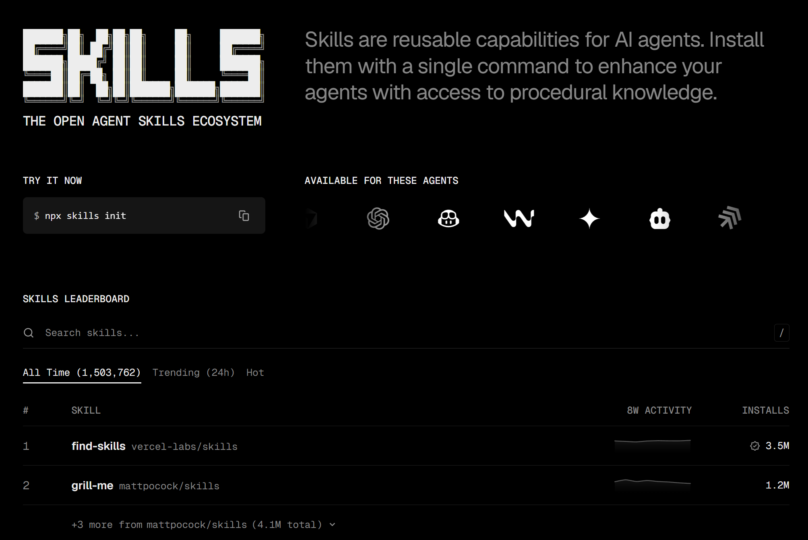

  

    <section class="cover-main">
      Talk · 60 minutes
      

        <h1 class="hero-title">From workflows to skills</h1>
        
A practical method for making your expertise reusable by agents

      

      

        
        +
        
      

    </section>
    <aside class="cover-side">
      

      

    </aside>
  

<!--
Timing: 1 minute
Open with the promise of the session. We will review useful skills, then show how to create one from a real workflow.
-->

---

  Your hosts
  <h1 class="slide-title">Two practices, one method</h1>
  

    <article class="profile framed speaker-card">
      

      

        <h2>Manar Benkraouda</h2>
        
CTO

        
The Tech Nation

      

    </article>
    <article class="profile framed speaker-card">
      

      

        <h2>Nicolas Grenié</h2>
        
Developer Advocate

        
SLNG

      

    </article>
  

<!--
Timing: 2 minutes
Frame the talk as a conversation. Manar leads the method. Nicolas brings product and field examples.
-->

---

  The next 60 minutes
  <h1 class="slide-title">From concept to practice</h1>
  

    
<b>01</b><strong>Context</strong>Workflows, skills and agent-native products

    
<b>02</b><strong>Method</strong>Turn one real workflow into a skill

    
<b>03</b><strong>5 skills</strong>Use cases and before / after evidence

    
<b>04</b><strong>Risks</strong>Portability, context and security

    
<b>05</b><strong>Questions</strong>Cases from the room

  

<!--
Timing: 1 minute
Set the pace. Keep at least five minutes for questions, and more if the room engages during the examples.
-->

---

  Why now
  

    

      <h1 class="massive">Products are becoming agent-native</h1>
      
A migration no longer ships only as a list of manual steps. It can ship as an instruction that an agent can execute.

    

    

      
BEFORE

      
Documentation that a person follows

      

      
NOW

      
A prompt or skill given to an agent

    

  

<!--
Timing: 3 minutes
SLNG example: the product assumes the user works with an agent. Distributing operational knowledge becomes part of the product itself.
Present this as an observed shift in AI-native products, not as a universal rule.
-->

---
layout: section
---

  

    
01 / UNDERSTAND

    <h1>Workflow and skill</h1>
    
Two terms that often get mixed together, but describe different things

  

<!--
Short section transition.
-->

---

  Definition
  <h1 class="slide-title">A workflow describes the work</h1>
  

    

      <h2>The sequence</h2>
      <ul>
        <li>A clear starting point</li>
        <li>Decisions made along the way</li>
        <li>An outcome you know how to judge</li>
      </ul>
    

    

      <WorkflowDiagram />
    

  

<!--
Timing: 2 minutes
Ask the room to name a workflow they already repeat. Focus on decisions and success criteria, not only on clicks.
-->

---

  Definition
  <h1 class="slide-title">A skill describes how to do it well</h1>
  

    

      
A skill turns instructions, examples and guardrails into reusable context.

    

    

      
skill-name/

      
&nbsp;&nbsp;SKILL.md

      
&nbsp;&nbsp;references/

      
&nbsp;&nbsp;examples/

      
&nbsp;&nbsp;scripts/

    

  

<!--
Timing: 2 minutes
A skill is not necessarily one file. It may include references, examples and scripts.
-->

---

  The distinction
  <h1 class="slide-title">The workflow remains the source</h1>
  

    
<b>01</b><strong>Workflow</strong>The real work, including decisions and exceptions

    
<b>02</b><strong>Conversation</strong>The agent attempts the work and receives corrections

    
<b>03</b><strong>Skill</strong>The reusable version of what you learned together

  

  
The goal is not to document every move. Capture the decisions that change the outcome.

<!--
Timing: 2 minutes
This relationship structures the rest of the talk. The conversation is the laboratory between workflow and skill.
-->

---
layout: section
---

  

    
02 / TRANSFORM

    <h1>From workflow to skill</h1>
    
A method built on observation, mistakes and the reasons behind each correction

  

<!--
Transition into the method.
-->

---

  Step 0
  <h1 class="slide-title">Search before you write</h1>
  

    

      <ol class="clean-list">
        <li><strong>Name the need</strong> Which outcome needs to become more reliable?</li>
        <li><strong>Explore directories</strong> Look for a credible starting point.</li>
        <li><strong>Read the skill</strong> Understand its instructions, scripts and permissions.</li>
        <li><strong>Adapt it</strong> Your examples matter more than a generic template.</li>
      </ol>
    

    

      
    

  

<!--
Timing: 2 minutes
Nicolas's point: the first step may be finding something that already exists. Never install before reading the contents.
Asset: screenshot and URL of the directory actually used.
-->

---

  Step 1
  <h1 class="slide-title">Run the workflow with the agent</h1>
  

    

      <strong>FIRST ATTEMPT</strong>
    

    

      <h2 style="font-size: 32px; text-transform: uppercase;">What to observe</h2>
      <ul class="clean-list">
        <li>Missing information</li>
        <li>Decisions that remained implicit</li>
        <li>Parts the agent already handled well</li>
      </ul>
    

  

<!--
Timing: 3 minutes
Avoid a live run. Use a prepared conversation to control timing and select an example that teaches something.
Asset: a screenshot that remains readable on a projector.
-->

---

  Step 2
  <h1 class="slide-title">Mistakes reveal the real rules</h1>
  

    

      <strong>AGENT MISTAKE</strong>
    

    

      <strong>CORRECTION + WHY</strong>
    

  

<!--
Timing: 3 minutes
Manar's central point: it is useful when the agent gets something wrong. Each mistake exposes a rule that was previously implicit.
-->

---

  Step 3
  <h1 class="slide-title">Separate the rule from its support</h1>
  

    
<b>01</b><strong>Instruction</strong>What the agent should do or avoid

    
<b>02</b><strong>Reason</strong>Why this rule protects the outcome

    
<b>03</b><strong>Example</strong>An output that makes the standard visible

    
<b>04</b><strong>Resource</strong>The template, reference or script that helps

  

<!--
Timing: 2 minutes
Keep SKILL.md readable and route to supporting material. Examples and scripts do not need to crowd the main instruction file.
-->

---

  Step 4
  <h1 class="slide-title">Anatomy of a skill</h1>
  

    

      
pr-writer/

      
&nbsp;&nbsp;SKILL.md

      
&nbsp;&nbsp;examples/

      
&nbsp;&nbsp;&nbsp;&nbsp;good-pr.md

      
&nbsp;&nbsp;&nbsp;&nbsp;bad-pr.md

      
&nbsp;&nbsp;templates/

      
&nbsp;&nbsp;&nbsp;&nbsp;pull-request.md

    

    

      
&#45;&#45;&#45;

      
name: pr-writer

      
description: Writes a PR in the company format.

      
&#45;&#45;&#45;

       
      
<strong># Expected result</strong>

      
A short, readable and verifiable PR.

       
      
<strong># Method</strong>

      
1. Read the template.

      
2. Identify the actual changes.

      
3. Compare with good examples.

      
4. Flag missing information.

    

  

<!--
Timing: 3 minutes
This is deliberately simplified. Replace it with the real structure of Nicolas's skill if it can be shared.
-->

---

  Step 5
  <h1 class="slide-title">Test repeatability</h1>
  <table class="test-table">
    <thead><tr><th>Case</th><th>What changes</th><th>Observable criterion</th><th>Status</th></tr></thead>
    <tbody>
      <tr><td>Nominal case</td><td>Complete input</td><td>Format passes without correction</td><td class="status todo">To test</td></tr>
      <tr><td>Incomplete context</td><td>One key fact is missing</td><td>The agent asks the right question</td><td class="status todo">To test</td></tr>
      <tr><td>Edge case</td><td>The template no longer fits</td><td>The agent states the limitation</td><td class="status todo">To test</td></tr>
    </tbody>
  </table>
  
A useful test does more than ask whether the output feels better. It checks a specific behavior.

<!--
Timing: 2 minutes
Complete this after running the tests. Keep at least one real edge case in the final deck.
-->

---

  Case study
  <h1 class="slide-title">A PR the team actually wants to read</h1>
  

    

      
Without the skill

      

        <strong>GENERIC PR</strong>
      

    

    

      
With the skill

      

        <strong>TEAM FORMAT</strong>
      

    

  

<!--
Timing: 4 minutes
This is the visual before / after requested in the meeting. Use the same code change on both sides.
Alternative: use a Linear ticket if the difference is clearer.
-->

---
layout: section
---

  

    
03 / DISCOVER

    <h1>Five skills to try</h1>
  

<!--
Transition into the recommendations.
-->

---

  Skill 01
  

    
1

    

      <h2>Humanizer</h2>
      
Turns generic AI copy into writing with a clearer, more natural voice.

      
WritingEditing

      
<strong>BEFORE / AFTER</strong>

    

  

<!--
Timing: 3 minutes
Confirm the exact skill name, source and activation command. Use a real text sample that can be shared publicly.
-->

---

  Skill 02
  

    
2

    

      <h2>Technical writer</h2>
      
Turns raw product knowledge into documentation that answers real questions.

      
DocumentationStructure

      
<strong>DOCUMENT SAMPLE</strong>

    

  

<!--
Timing: 3 minutes
Confirm the exact skill name and source. Show one short section before and after the skill.
-->

---

  Skill 03
  

    
3

    

      <h2>Impeccable</h2>
      
Makes UI and design-system feedback specific enough to act on.

      
UI critiqueDesign systems

      
<strong>UI CRITIQUE</strong>

    

  

<!--
Timing: 3 minutes
Add the exact command and one observation produced on a real interface.
-->

---

  Skill 04
  

    
4

    

      <h2>[SKILL NAME]</h2>
      
[ONE-LINE USE CASE]

      
<strong>DEMO</strong>

    

  

<!--
Timing: 3 minutes
Choose a broadly understandable skill with a visible improvement.
-->

---

  Skill 05
  

    
5

    

      <h2>[SKILL NAME]</h2>
      
[ONE-LINE USE CASE]

      
<strong>DEMO</strong>

    

  

<!--
Timing: 3 minutes
Choose a different domain from the first four skills. Keep the Cursor skill pack as the technical backup option.
-->

---
layout: section
---

  

    
04 / RISKS

    <h1>Portability, context and security</h1>
  

<!--
Transition into the risks and constraints of using skills across tools.
-->

---

  Portability
  <h1 class="slide-title">The expertise travels better than the format</h1>
  

    
<b>01</b><strong>Claude</strong>Instructions, references and tools

    
<b>02</b><strong>Codex</strong>Local skills and project rules

    
<b>03</b><strong>Cursor</strong>Rules, commands and resources

    
<b>04</b><strong>OpenCode</strong>Skills and project instructions

  

  
The wrapper changes. The decisions, examples and quality bar can stay.

<!--
Timing: 3 minutes
Nuance the claim. A skill is not always copied unchanged. The knowledge transfers, then the packaging adapts to each agent.
-->

---

  Directories
  <h1 class="slide-title">A directory is a starting point</h1>
  

    
<h2 style="font-size: 34px; text-transform: uppercase;">Discover</h2>
Find a credible starting point.

    
<h2 style="font-size: 34px; text-transform: uppercase;">Inspect</h2>
Read instructions, scripts and access.

    
<h2 style="font-size: 34px; text-transform: uppercase;">Adapt</h2>
Replace generic examples with yours.

  

<!--
Timing: 2 minutes
Add the directory Nicolas uses and any other validated source. Verify names, URLs and adoption figures before the talk.
-->

---

  Context window
  

    

      <h1 class="massive">Every loaded skill spends context</h1>
      
More instructions can make the useful instructions harder to find.

    

    

      <ul class="clean-list" style="margin-top: 0;">
        <li>Activate narrowly</li>
        <li>Load references only when needed</li>
        <li>Remove duplicates and stale variants</li>
      </ul>
    

  

<!--
Timing: 2 minutes
Connect this to context limits and instruction retrieval. Avoid claiming a universal maximum number of skills.
-->

---

  Security
  

    

      <h1 class="massive">A skill can run code</h1>
      
It may read files, execute scripts or call an API.

    

    
!

  

  

    <strong style="font-family: 'Space Grotesk Variable'; font-size: 24px;">Carapace case</strong>
    
A skill makes an API call. Agent behavior around confirmation varies.

  

<!--
Timing: 3 minutes
Verify the current behavior at joincarapace.com before the talk. Present it as an illustration of execution risk, not an allegation of malicious intent.
-->

---

  Before installing
  <h1 class="slide-title">The minimum checklist</h1>
  

    
<b>01</b><strong>Source</strong>Author, repository, history

    
<b>02</b><strong>Instructions</strong>Read SKILL.md in full

    
<b>03</b><strong>Scripts</strong>Inspect commands and dependencies

    
<b>04</b><strong>Access</strong>Files, network, credentials

    
<b>05</b><strong>Test</strong>Start with a limited scope

  

<!--
Timing: 2 minutes
Built-in agent checks help, but human review remains necessary.
-->

---

  Try it tomorrow
  <h1 class="slide-title" style="max-width: 1100px;">Your first skill in 45 minutes</h1>
  

    
<b>10'</b><strong>Choose</strong>One repeated workflow

    
<b>15'</b><strong>Run</strong>Work with the agent and correct it

    
<b>10'</b><strong>Ask Claude</strong>Create a skill from what we learned in the session

    
<b>10'</b><strong>Test</strong>Use one normal case and one edge case

  

  
Start with work you already know how to judge.

<!--
Timing: 2 minutes
Offer this as the immediate next step. Ask participants to write down one workflow they would choose.
-->

---
layout: end
---

  

    Questions
    <h1 class="massive" style="margin-top: 38px;">Which workflow should become your next skill?</h1>
    

      
      +
      
    

  

<!--
Timing: at least 5 minutes
If the room hesitates, ask for a task that is frequent, tedious or dependent on an internal format.
-->
