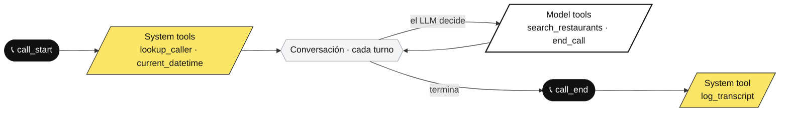

---
# ============================================================
# TALLER — Agentes de voz con IA con slng.ai
# SLNG brand (white / grey-01 / black, #FBE566 yellow,
# rounded-square shapes, "//" motif, Saans + Geist Mono).
# Built from slides-template-slng. Deck de introducción (framing).
# ============================================================
theme: default
aspectRatio: 16/9
canvasWidth: 1920
title: "Agentes de voz con IA: construye el tuyo en 3 horas con slng.ai"
info: |
  Nicolas Grenié · @picsoung
  Taller completo: construye y despliega un agente de voz con IA en 3 horas con slng.ai.
author: Nicolas Grenié
highlighter: shiki
lineNumbers: false
drawings:
  persist: false
transition: fade
mdc: true
fonts:
  sans: Saans
  mono: Geist Mono
# Chrome config — change these once, they propagate everywhere.
venue: "Upskilling Week · Barcelona · 2026"
handle: "@picsoung"
tagline: "slng.ai — infraestructura de voz con IA en tiempo real."
layout: cover
date: "2026"
class: slng-dark
hideInToc: true
---

<!-- ============================================================
     SLIDE 1 — PORTADA  (layout: cover)
     Oscura. Logo SLNG// arriba-izq, título grande, tagline + fecha.
     ============================================================ -->

Agentes de voz con IA: construye el tuyo en 3 horas.

---
layout: center
class: slng-dark
---

<!-- ============================================================
     SLIDE 2 — INTRO PERSONAL  (reutilizada del deck de Lovable)
     ============================================================ -->

  
  

    <h1 class="text-7xl font-extrabold mb-8">
      Hola, soy Nicolas.
    </h1>
    

      
DevRel @ slng.ai

      
Vivo en Barcelona

      
Lovable Ambassador

      
Antes · Typeform · Red Hat

    

  

---
layout: center
class: slng-dark
---

<!-- ============================================================
     SLIDE 3 — SIGUE EL MATERIAL (QR)  — patrón reutilizado de la deck de Lovable
     QR → https://upskilling-workshop.lovable.app/  (public/images/qr/material.svg)
     ============================================================ -->

Antes de empezar

Sigue el material

  

Escanéalo y síguelo a tu ritmo — upskilling-workshop.lovable.app

<!--
SPEAKER: Antes de tocar nada, todos abren el material del taller con el QR. Ahí están
las guías paso a paso, los prompts completos y los enlaces (incluida la base de datos).
Que nadie se quede sin escanearlo — lo seguimos en paralelo durante las 3 horas.
-->

---
layout: default
class: slng-light
---

<!-- ============================================================
     SLIDE 4 — ¿QUÉ ES slng.ai?  (presentación del producto)
     ============================================================ -->

  <h1 class="slide-title">¿Qué es slng.ai?</h1>

  La infraestructura para construir y desplegar <strong>agentes de voz con IA</strong>
  en tiempo real. Voz natural, lógica conversacional y conexión a tus herramientas,
  detrás de una sola API.

  

    
01

    
Voz natural

    
STT, LLM y TTS orquestados con baja latencia para una conversación fluida.

  

  

    
02

    
Lógica conversacional

    
Prompts, turnos y flujos preparados para producción, no solo demos.

  

  

    
03

    
Herramientas externas

    
Conecta APIs, calendarios y CRMs directamente en la llamada.

  

---
layout: default
class: slng-dark
---

<!-- ============================================================
     SLIDE 4 — AGENDA
     ============================================================ -->

  <h1 class="slide-title">Agenda</h1>
  
3 horas · manos a la obra

<ol class="text-2xl font-medium leading-relaxed list-decimal pl-10 space-y-2 mt-4">
  <li>Arquitectura de un agente de voz: STT, LLM, TTS, tools y lógica de turno</li>
  <li>Construir y probar tu agente en la UI de slng.ai</li>
  <li>Darle datos y acciones reales con herramientas (APIs, calendarios, CRMs)</li>
  <li>Prompts y flujos conversacionales listos para producción</li>
  <li>Publicarlo: conéctalo a un número o embébelo en tu web — lo rápido</li>
  <li>Coste por llamada, límites y cuándo usar un agente de voz</li>
</ol>

---
layout: default
class: slng-light
---

<!-- ============================================================
     SLIDE 5 — OBJETIVOS
     ============================================================ -->

  <h1 class="slide-title">Al finalizar, serás capaz de…</h1>

  
Explicar la arquitectura de un agente de voz con IA: STT, LLM, TTS, tools y lógica de turno.

  
Construir y probar un agente funcional en la UI de slng.ai.

  
Darle datos y acciones reales integrando herramientas externas (APIs, calendarios, CRMs).

  
Diseñar prompts y flujos conversacionales preparados para producción.

  
Publicarlo cuando esté listo — a un número de teléfono o embebido en tu web.

  
Evaluar coste por llamada, límites y cuándo un agente de voz es la solución correcta.

---
layout: default
class: slng-light
---

<!-- ============================================================
     SLIDE 6 — REQUISITOS
     ============================================================ -->

  <h1 class="slide-title">Requisitos</h1>

  

    
01

    
Portátil + Wi-Fi

    
Tu propio portátil con conexión Wi-Fi.

  

  

    
02

    
Navegador moderno

    
Chrome, Firefox, Edge o Safari actualizado.

  

  

    
03

    
Cuenta de slng.ai

    
Cuenta gratuita creada antes del taller. Damos créditos para la sesión.

  

  

    
04

    
Móvil personal

    
Para probar en vivo el agente cuando lo publiques a un número.

  

Todo se construye en el navegador — nada de instalar Node ni clonar repos.

---
layout: section
no: 1
class: slng-light
---

<!-- ============================================================
     SECCIÓN 01 — LOS 3 ACTORES (arquitectura)
     ============================================================ -->

Los 3 actores de un agente de voz

---
layout: default
class: slng-dark
---

<!-- ---- Pipeline: el mapa ---- -->

  <h1 class="slide-title">Oído → Cerebro → Boca</h1>
  
// el bucle que se repite en cada turno

  

    
👂

    
STT · el oído

    
Audio → Texto

    
Transcribe lo que dices en tiempo real, mientras hablas.

  

  
→

  

    
🧠

    
LLM · el cerebro

    
Texto → Decisión

    
Entiende, decide qué responder — o qué herramienta usar.

  

  
→

  

    
👄

    
TTS · la boca

    
Texto → Voz

    
Convierte la respuesta en voz natural, con la personalidad que elijas.

  

⏱ Todo esto, en menos de ~800 ms — o la conversación se siente rara.

<!--
SPEAKER: Este bucle corre en CADA turno de la conversación. La latencia total es la
suma de los tres + la red. Por eso importa dónde se ejecuta (región) y qué modelo se
usa en cada paso — exactamente lo que optimiza SLNG. Vamos a ver cada actor de cerca.
-->

---
layout: default
class: slng-light
---

<!-- ---- TTS ---- -->

  
Actor 1 · La boca

  <h1 class="slide-title">TTS — Text to Speech</h1>

  Un modelo + una voz + el texto y ya habla. Lo que <strong>tú controlas</strong> son estos
  parámetros — la latencia no: esa la marca el modelo que elijas.

  voz (voice id)
  velocidad
  tono
  emoción / expresividad
  pronunciación
  idioma

// Modelos en SLNG

  
Cartesia

  
Deepgram

  
ElevenLabs

  
Inworld

  
KugelAudio

  
Murf

  
Rime

  
Sarvam AI

  
Soniox

  
Gradium

▶︎ <a href="https://examples-gbcy.onrender.com/" target="_blank" class="accent" style="text-decoration:none">Prueba las voces →</a>

<!--
SPEAKER: La boca. Con modelo + voz + texto ya habla. Los parámetros son afinación — no
hay que memorizarlos, solo saber que existen. OJO: la latencia NO es un ajuste, la fija
el modelo; por eso importa elegir bien. La voz ES una decisión de producto: es tu marca
sonora. En SLNG eliges entre 10 proveedores / 14 modelos de TTS.
-->

---
layout: default
class: slng-light
---

<!-- ---- STT ---- -->

  
Actor 2 · El oído

  <h1 class="slide-title">STT — Speech to Text</h1>

  Le das el audio y te devuelve texto. Lo que <strong>tú ajustas</strong> es cómo escucha —
  y el <strong>endpointing</strong> es el que más se nota: decide cuándo has terminado de hablar.

  idioma
  vocabulario (keywords boost)
  endpointing
  puntuación / formato
  diarización
  streaming / partials

// Modelos en SLNG

  
Deepgram

  
Reson8

  
Sarvam AI

  
Soniox

  
Gradium

▶︎ <a href="https://slng-stt-demo.onrender.com/" target="_blank" class="accent" style="text-decoration:none">Pruébalo en directo →</a>

<!--
SPEAKER: El oído. El detalle que más afecta a la experiencia es el ENDPOINTING: si
corta pronto, te interrumpe; si corta tarde, hay silencios incómodos. Es el "turno"
de la conversación. El vocabulario reforzado salva nombres de negocio ("TechFix",
"Razzmatazz") que un modelo genérico destrozaría.
-->

---
layout: default
class: slng-light
---

<!-- ---- LLM ---- -->

  
Actor 3 · El cerebro, en medio

  <h1 class="slide-title">LLM — el que decide</h1>

  

    
Recibe

    
La transcripción del STT + tu system prompt (quién es, cómo habla) + la lista de herramientas disponibles.

  

  

    
Decide

    
¿Respondo con lo que sé? ¿Llamo a una herramienta? ¿Pido un dato que falta? ¿Confirmo antes de actuar?

  

  

    
Produce

    
Texto — que el TTS convierte en voz al instante, frase a frase.

  

  

    
Su límite

    
Solo sabe lo que había en su entrenamiento + lo que le des. Todo lo demás: herramientas. (Esto va a ser el hilo de todo el taller.)

  

// Conéctalo al modelo que quieras

  
OpenAI

  
NVIDIA

  
Gemini

<!--
SPEAKER: El cerebro está EN MEDIO — no oye ni habla; lee y escribe texto. Dos ideas
clave: (1) el system prompt es tu único volante sobre su comportamiento; (2) su
conocimiento está congelado en el tiempo. Esa segunda limitación la vamos a ver en
carne propia en 10 minutos — y la resolveremos con tools.
-->

---
layout: section
no: 2
class: slng-light
---

<!-- ============================================================
     SECCIÓN 02 — TU PRIMER AGENTE (recomendador de restaurantes BCN)
     ============================================================ -->

Tu primer agente: recomienda dónde comer en Barcelona

---
layout: default
class: slng-dark
---

<!-- ---- Contexto del proyecto ---- -->

  <h1 class="slide-title">El proyecto: BCN Concierge</h1>
  
// un conserje por teléfono — y empezamos por los restaurantes

  

    
01

    
Recomienda restaurantes

    
"¿Dónde ceno bien cerca del Born esta noche?" — por cocina, barrio y precio.

  

  

    
02

    
Responde dudas

    
Horario, rango de precio, si aceptan reserva, cómo llegar.

  

  

    
03

    
Reserva mesa

    
Te reserva con tus datos — y si ya te conoce, mejor todavía.

  

Un conserje puede con todo; nosotros empezamos por comer. Y lo construimos por capas.

<!--
SPEAKER: Nuestro fil rouge. Un conserje telefónico para Barcelona que EMPIEZA por los
restaurantes — el mismo patrón sirve luego para hoteles, planes, lo que sea. Partimos de
lo mínimo (un prompt y una voz) y apilamos capas: tono → reloj → base de restaurantes →
reserva personalizada. En cada capa, llamamos y escuchamos la diferencia.
-->

---
layout: default
class: slng-light
---

<!-- ---- Prompt v0: el primer agente, sin conectar a nada ---- -->

  
Capa 1 · El primer prompt

  <h1 class="slide-title">Un prompt. Una voz. Nada más.</h1>

<pre class="prompt-card"># v0 — deliberadamente simple. Sin tools, sin datos.
You are a restaurant concierge for Barcelona.
Callers ask you where to eat: cuisine, neighborhood,
budget, occasion.

Answer their questions and recommend restaurants.
Speak Spanish.</pre>

▶︎ Demo — lo probamos en la UI de slng.ai: ¿dónde ceno esta noche? 👂

<!--
SPEAKER / DEMO: Crear el agente con este prompt + una voz del catálogo. Llamar en vivo:
"¿dónde ceno bien por el Born?". Funciona… pero suena a asistente genérico y recomienda
sitios vagos o que quizá ya cerraron. No lo critiques todavía — deja que la sala lo note.
La siguiente slide pone nombre al problema.
-->

---
layout: default
class: slng-light
---

<!-- ---- ¿De dónde saca lo que sabe? ---- -->

  <h1 class="slide-title">¿De dónde saca lo que sabe?</h1>

  
Del <strong>entrenamiento del LLM</strong> — una foto del pasado, congelada.

  
Sabe que Barcelona está llena de restaurantes. No sabe cuáles siguen abiertos, ni si hoy tienen mesa.

  
Y cuando no sabe… <strong>rellena los huecos</strong> — te manda a un sitio que cerró en 2019.

Su conocimiento tiene fecha de caducidad — y no nos lo va a confesar.

<!--
SPEAKER: El problema central de los agentes "solo prompt": el LLM no tiene acceso al
mundo. Todo lo que "sabe" de los restaurantes de Barcelona es del entrenamiento — puede
tener años. Y los LLM prefieren inventar antes que callar. Primera mitad de la solución:
mejor prompt. Segunda mitad (la importante): tools. Vamos con la primera.
-->

---
layout: default
class: slng-light
---

<!-- ---- Prompt v1: tono y forma de hablar ---- -->

  
Capa 2 · El prompt se oye

  <h1 class="slide-title">Mismo agente, otra personalidad</h1>

<pre class="prompt-card">You are Montse, the concierge of BCN Concierge — a phone
service that helps people find great places to eat in Barcelona.

## How you speak
- Warm, upbeat, like a well-connected local friend
- SHORT sentences. This is a phone call, not an essay.
- Natural Spanish fillers: "a ver…", "mira", "genial"
- One recommendation at a time, then ask if they want more
- Never read lists. Never use formatting.

## Rules
- If you are not sure about something, SAY SO.
- Never invent restaurants, prices or opening hours.

Speak Spanish (Spain).</pre>

▶︎ Demo A/B — misma pregunta que antes. Escucha la diferencia.

<!--
SPEAKER / DEMO: Verde = lo nuevo respecto a v0. Misma pregunta ("¿dónde ceno hoy?") y la
sala ESCUCHA el cambio: ahora suena a persona, con muletillas, frases cortas, una
recomendación por turno. Lección: el prompt es el volante del tono. PERO — y aquí viene
la trampa — sigue sin saber qué día es hoy. Pregúntale si un sitio abre esta noche…
-->

---
layout: default
class: slng-light
---

<!-- ============================================================
     TOOLS — MAPA: cuándo puede actuar una tool (lifecycle)
     ============================================================ -->

  
Las herramientas

  <h1 class="slide-title">¿Cuándo puede actuar una tool?</h1>

  Una tool es algo que el agente <strong>hace</strong>, no solo dice. Hay dos tipos, según
  <strong>quién</strong> la dispara y <strong>cuándo</strong> en la llamada.

  

System

Las dispara un <strong>evento</strong> del runtime (call_start, call_end). El LLM ni se entera.

  

Model

Las decide el <strong>LLM</strong> a mitad de conversación, leyendo la descripción de cada tool.

<!--
SPEAKER: El mapa mental de las tools antes de tocar ninguna. Dos preguntas: ¿QUIÉN la dispara
y CUÁNDO? System tools = un evento del runtime (al descolgar, al colgar); el LLM ni las ve.
Model tools = las elige el LLM mientras habla, según la descripción. Todo lo que viene ahora
encaja en este diagrama: end_call y search_restaurants son model; el lookup del llamante y el
guardado de la transcripción son system. Volveremos a este mapa.
-->

---
layout: default
class: slng-light
---

<!-- ---- Tool 0: end_call (la herramienta más simple, la primera) ---- -->

  
Capa 3 · Su primera herramienta

  <h1 class="slide-title">Saber cuándo colgar</h1>

  La tool más simple que existe — y la primera: <strong>colgar</strong>. Una built-in de SLNG,
  cero backend. Sin ella el agente se queda al teléfono para siempre; con ella <strong>hace</strong>
  algo, no solo habla. Esa es la idea de una tool.

built-in · end_call

<pre class="prompt-card"># …añadimos al prompt:
## Tools
- end_call: hang up when the conversation is over —
  the caller said goodbye, or the booking is done.</pre>

▶︎ Demo — te despides… y cuelga sola. 👋

<!--
SPEAKER / DEMO: La forma más suave de introducir "tools": la más simple de todas — colgar.
Built-in de SLNG (cero backend, un interruptor). Establece la idea clave: una tool es algo
que el agente HACE, no solo dice. Sin ella la llamada no termina bien. Se la presentamos en
el prompt (verde) para que sepa CUÁNDO usarla. En la siguiente, una tool que le da INFO del
mundo real.
-->

---
layout: statement
class: slng-dark
---

<!-- ---- El problema de la fecha ---- -->

Suena mejor. Pero le preguntas si un sitio abre esta noche… y no sabe ni qué día es hoy.

<!--
SPEAKER: Demo rápida si no salió sola: "¿qué día es hoy?" → duda, o suelta una fecha
inventada con total confianza. "Esta noche" o "mañana" no significan NADA para un modelo
congelado en el tiempo. Ninguna mejora de prompt arregla esto. Necesitamos darle acceso
al presente con otra herramienta.
-->

---
layout: default
class: slng-light
---

<!-- ---- Tool 1: current_datetime ---- -->

  
Capa 4 · Su segunda herramienta

  <h1 class="slide-title">Darle un reloj</h1>

  Otra built-in de SLNG — y la primera que le trae <strong>datos del mundo real</strong>: la
  fecha y hora de hoy. Cero backend, la activas y ya. Y se lo decimos en el prompt.

built-in · current_datetime

<pre class="prompt-card"># …lo de antes, y añadimos al prompt:
## Tools
- current_datetime: use it to know today's date and time,
  e.g. to interpret "esta noche", "mañana" or "este finde".</pre>

▶︎ Demo — "¿qué día es hoy?" → ahora sí. Y "esta noche" ya significa algo.

<!--
SPEAKER / DEMO: Segunda tool — y la primera que trae DATOS del mundo real: la fecha. Aquí
el agente SALE del LLM para consultar el presente. Otra built-in de SLNG: cero backend, un
interruptor. Se la presentamos en el
prompt (verde) para que sepa CUÁNDO usarla — sin enseñar el JSON, el detalle está en el
handout. Ahora "esta noche" se calcula de verdad. Patrón que se repetirá: lo que el LLM
no sabe, una tool se lo da.
-->

---
layout: default
class: slng-light
---

<!-- ---- La base de restaurantes ---- -->

  
Capa 5 · Datos de verdad

  <h1 class="slide-title">Nuestra base de restaurantes</h1>

  Una base sencilla de restaurantes de Barcelona. Nada sofisticado, a propósito: lo que
  importa es <strong>cómo la consulta el agente</strong>, no la base en sí.

  nombre
  cocina
  barrio
  precio
  horario
  acepta reserva

  <a href="https://picsoung--0dd364ec75f611f1ab6f1607ee4eb77e.web.val.run" target="_blank"
     style="display:inline-flex;align-items:center;gap:0.5rem;font-family:'Geist Mono',monospace;font-size:1.1rem;padding:0.55rem 1.1rem;border-radius:10px;background:var(--slng-yellow);color:var(--slng-black);text-decoration:none">🔗 Explora la base de datos →</a>

La pregunta: ¿cómo hace el agente para consultarla?

<!--
SPEAKER: Los restaurantes REALES viven aquí — una base mock servida por el backend del
taller (enlace en la slide: ábrela y enséñala). Deliberadamente simple: la lección no es
la base de datos, es CÓMO el agente la consulta. En producción esto sería vuestra DB,
vuestro CMS o vuestra API de reservas — el patrón es idéntico.
-->

---
layout: default
class: slng-light
---

<!-- ---- Tool 2: search_restaurants (webhook) ---- -->

  
Capa 5 · Webhook tool

  <h1 class="slide-title">El agente consulta la base</h1>

  Añadimos una <strong>herramienta webhook</strong>. El LLM decide cuándo llamarla leyendo
  su <strong>descripción</strong> — así que la descripción es, en la práctica, su prompt.

webhook · search_restaurants

<pre class="prompt-card"># endpoint — un val de Val Town (URL en el material)
POST  https://picsoung--0dd364ec…​.web.val.run

# description → cuándo y por qué llamarla:
Searches the restaurant database and returns the
available restaurants with their name, cuisine,
price range, neighborhood, signature dish, and
rating. Call this once you know what the caller
is in the mood for (a cuisine, a vibe, a
neighborhood, or a budget) so you can recommend
real restaurants from the results instead of
guessing names yourself.</pre>

▶︎ Demo — "¿un japonés bueno por Gràcia?" → restaurantes reales, de la base.

<!--
SPEAKER / DEMO: La cadena completa por primera vez: reloj (tool 1) + búsqueda (tool 2).
Si preguntan "¿algo abierto esta noche?", el LLM saca la fecha con el reloj, llama a
search_restaurants con los filtros correctos y responde con sitios de la base, no
inventados. Señala la magia: NADIE programó ese flujo; el LLM encadenó las dos tools
solo, guiado por las descripciones. Por eso las descripciones importan tanto.
-->

---
layout: default
class: slng-light
---

<!-- ---- Reservas: pedir datos… ¿o ya los tenemos? ---- -->

  
Capa 6 · La reserva

  <h1 class="slide-title">"¿Me reservas mesa?" — datos del llamante</h1>

  

    <h3 class="strike-muted">Opción A · Preguntarlo todo</h3>
    <ol>
      <li>"¿Su nombre?" … "¿Su teléfono?"</li>
      <li>Deletrear, repetir, confirmar…</li>
      <li>Funciona — pero es lento e impersonal</li>
    </ol>
  

  

    <h3>Opción B · Ya lo sabemos</h3>
    <ol>
      <li>El <strong>número del llamante</strong> viene con la llamada</li>
      <li>Al descolgar, buscamos en nuestra base de clientes</li>
      <li>El agente saluda <strong>por tu nombre</strong> y reserva la mesa sin pedirte nada</li>
    </ol>
  

La información que ya tienes no se pregunta — se usa.

<!--
SPEAKER: El salto de UX. En una llamada real ya sabes el número del llamante — y si
es cliente, sabes su nombre y su historial. Concepto nuevo: hasta ahora todas las
tools las decidía el LLM (model tools). Esta se dispara SOLA al conectar la llamada:
una SYSTEM tool en el evento call_start. La config, en la siguiente slide.
-->

---
layout: default
class: slng-light
---

<!-- ---- Tool 3: lookup del llamante en call_start ---- -->

  
Capa 6 · System tool en call_start

  <h1 class="slide-title">Reconocerte al descolgar</h1>

  Hasta ahora las tools las decidía el LLM. Esta es distinta: una <strong>system tool</strong>
  que el runtime dispara al conectar la llamada (call_start) y busca al llamante en la base
  de clientes. En teléfono el número viene con la llamada; en web lo pasas como argumento — la tool lo resuelve igual.

system tool · call_start

<pre class="prompt-card"># el saludo es genérico; el prompt le dice que use lo que devuelve la tool:
## Caller context
- On call_start you receive the caller's profile (name, tastes).
- If you recognize them, greet them by name on your FIRST reply,
  e.g. "¡Ah, hola Carmen! ¿Otra vez japonés?"
- Offer to book using the number they're calling from.</pre>

▶︎ Demo — llamas desde tu número… y te saluda por tu nombre. 🤯

<!--
SPEAKER / DEMO: El momento "wow" de la primera parte. Antes de que digas nada, el runtime
ya buscó tu número en la base de clientes y el saludo viene personalizado — incluso con
tu cocina favorita. Y en la reserva: "te apunto con el número desde el que llamas, ¿vale?"
— cero fricción. Cierra con la pregunta ética: ¿cuándo es útil y cuándo inquieta que un
robot te reconozca? (30 segundos de sala.)
-->

---
layout: default
class: slng-light
---

<!-- ---- Capa 7: Después de la llamada (call_end → transcripts → dashboard) ---- -->

  
Capa 7 · Después de la llamada

  <h1 class="slide-title">Cada llamada deja rastro</h1>

  Otra system tool — esta se dispara en <strong>call_end</strong>. Manda la transcripción a un
  endpoint que la guarda, la resume y extrae qué recomendaste y si acabó en reserva.

system tool · call_endlog_transcript

  

    <h3>📝 Se guarda sola</h3>
    <ol>
      <li>Al colgar, la llamada entera va a tu endpoint.</li>
      <li>Un LLM la resume: recomendación, resultado, cliente.</li>
    </ol>
  

  

    <h3>📊 Dashboard</h3>
    <ol>
      <li>Todas las llamadas, con filtro por resultado.</li>
      <li>Reservas, "top picks" y transcripción completa.</li>
    </ol>
  

▶︎ <a href="https://picsoung--a87c515675f711f19a141607ee4eb77e.web.val.run" target="_blank" class="accent" style="text-decoration:none">Abre el dashboard →</a>

<!--
SPEAKER: El cierre del bucle. Ya vimos una system tool en call_start (reconocer al llamante);
esta es la simétrica en call_end: al colgar, SLNG manda la transcripción a un endpoint que la
guarda y la resume con un LLM (resumen, restaurante recomendado, resultado). El pago: un
dashboard con todas las llamadas. Mismo patrón que ya conocen — otro evento, otra system tool.
-->

---
layout: default
class: slng-light
---

<!-- ---- Capa 8: Publícalo (deploy — número o embed) ---- -->

  
Capa 8 · Publícalo

  <h1 class="slide-title">Ya funciona. Publícalo.</h1>

  Lo construiste y lo probaste en la UI de slng.ai. Sacarlo al mundo es lo <strong>rápido</strong>:

  

    <h3>📞 Un número de teléfono</h3>
    <ol>
      <li>Le asignas un número y ya recibe y hace llamadas de voz reales.</li>
      <li>Ideal para soporte, reservas, recepción.</li>
    </ol>
  

  

    <h3>🌐 Embebido en tu web</h3>
    <ol>
      <li>Un widget de voz en tu página, con unos clics.</li>
      <li>Ideal para un "habla con nosotros" dentro del producto.</li>
    </ol>
  

  número de teléfono
  widget web
  ~2 min

▶︎ Demo — le ponemos número y lo llamamos de verdad. 📞

<!--
SPEAKER: Cierre del build: todo lo anterior lo montaste y probaste en la UI de slng.ai.
Publicar es lo rápido — un número de teléfono o un widget web en un par de minutos. Aquí tu
agente pasa de "funciona en mi pantalla" a estar en producción, recibiendo llamadas reales.
Con esto cerramos la primera parte.
-->

---
layout: default
class: slng-dark
---

<!-- ---- Recap de la primera parte + teaser ---- -->

  <h1 class="slide-title">Lo que tu agente ya hace</h1>
  
// y todavía no hemos escrito un backend "de verdad"

  
✓ Habla con una personalidad que elegiste tú (y se oye)

  
✓ Sabe qué día y hora es — built-in current_datetime

  
✓ Recomienda restaurantes reales — webhook a nuestra base

  
✓ Te reconoce al descolgar — system tool en call_start

  
✓ Reserva mesa sin pedirte el teléfono

  
✓ Guarda y resume cada llamada — system tool en call_end

Todo esto, a mano en la UI. ¿Y si pudieras ir aún más rápido? 👇

<!--
SPEAKER: Pausa de consolidación. Recorre la escalera: prompt → tono → reloj → base de
restaurantes → publicar → reconocimiento. Dos conceptos que ya dominan sin saberlo: model
tools (las decide el LLM) y system tools (las dispara un evento). Ya lo saben hacer TODO a
mano en la UI — ahora dos formas de acelerar: hablarle a SLNG desde Claude, y montar tools
sin backend con n8n/Zapier. Las dos siguientes slides.
-->

---
layout: default
class: slng-dark
---

<!-- ============================================================
     BONUS 1 — SUBE DE NIVEL: habla con SLNG desde Claude (skills)
     ============================================================ -->

  
Sube de nivel

  <h1 class="slide-title">Habla con SLNG desde Claude</h1>

  Las <strong>skills</strong> de SLNG conectan un LLM (Claude y otros) con slng.ai. Le pides
  en lenguaje natural — "crea un agente que…", "añade una tool que…" — y lo monta por ti.

  
Claude

  
+ tu LLM

Menos clics, más conversación — SLNG hace la mayor parte.

<!--
SPEAKER: Una vez que entienden el modelo mental (agentes, tools, eventos), no hace falta
hacerlo todo a mano. Las skills de SLNG dejan que Claude conduzca: describes lo que quieres
y te construye el agente y sus tools. La UI para aprender; las skills para ir rápido.
-->

---
layout: default
class: slng-dark
---

<!-- ============================================================
     BONUS 2 — TOOLS SIN BACKEND: n8n / Zapier
     ============================================================ -->

  
Sube de nivel

  <h1 class="slide-title">Tools sin escribir un backend</h1>

  Una tool es, por dentro, un <strong>endpoint privado</strong> — tu API. Puede ser tu propio
  servicio (las de este taller viven en <strong>Val Town</strong>), o, si no quieres mantener
  servidor, un flujo visual en <strong>n8n</strong> o <strong>Zapier</strong>. Mismo patrón, cero fricción.

  
Val Town · tu API

  
n8n

  
Zapier

Tu propia API o un flujo de arrastrar y soltar — el agente la llama igual.

<!--
SPEAKER: El search_restaurants de antes era un webhook a una API — en este taller, un val de
Val Town (cero servidor que mantener, HTTPS al instante). En producción esa API es tuya, o la
montas sin código: n8n / Zapier exponen un webhook, tú arrastras los pasos (consultar DB, CRM,
enviar un SMS) y SLNG lo llama igual.
-->

---
layout: closing
contact: "hola@slng.ai · slng.ai · @picsoung"
---

<!-- ============================================================
     SLIDE — CIERRE  (layout: closing)
     ============================================================ -->

¡Manos a la obra!

---
layout: center
class: slng-dark
---

<!-- ============================================================
     SLIDE FINAL — FEEDBACK (QR)  — patrón reutilizado de la deck de Lovable
     QR → mismo formulario de feedback (public/images/qr/feedback.svg)
     ============================================================ -->

¡Gracias! ¿preguntas?

  

Déjame tu feedback en 1 minuto · {{ $slidev.configs.handle }} · slng.ai

<!--
SPEAKER: Slide final. Responde preguntas con el QR en pantalla; el enlace va al formulario
de feedback (el mismo del curso). Deja el handle visible mientras la sala lo rellena.
-->

