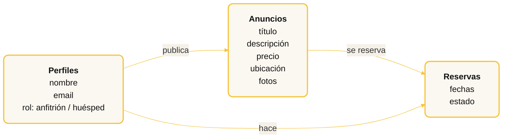

---
# ============================================================
# TALLER · De idea a SaaS en 5 horas
# "Clona Airbnb para lo que quieras con Lovable"
# Skeleton — rellena el contenido marcado con TODO.
# Branding: slidev-brand-template (cream + dark + yellow/gold).
# ============================================================
theme: default
aspectRatio: 16/9
canvasWidth: 1920
title: De idea a SaaS en 5 horas con Lovable
info: |
  Nicolas Grenié · @picsoung
  Taller completo: de una idea a un SaaS desplegado en producción con Lovable.
author: Nicolas Grenié
highlighter: shiki
lineNumbers: false
drawings:
  persist: false
transition: fade
mdc: true
fonts:
  sans: Inter
  mono: JetBrains Mono
venue: "MWC Upskilling Week · Barcelona · 2026"
handle: "@picsoung"
class: ng-dark
hideInToc: true
hideChrome: true
---

<!-- ============================================================
     SLIDE 1 — PORTADA OFICIAL DEL EVENTO (Lovable.pdf)
     Full-bleed; sin chrome (hideChrome en el headmatter).
     ============================================================ -->

---
layout: default
class: ng-dark
---

<!-- ============================================================
     SLIDE 2 — TÍTULO
     ============================================================ -->

  

    
Taller completo · Desarrollo de software

    <h1 class="title-headline" style="font-size:8rem;">
      De idea a SaaS 
      en 5 horas
    </h1>
    

      Clona Airbnb para lo que quieras con
      
        Lovable
    

    

      Nicolas Grenié · {{ $slidev.configs.handle }}
    

    

      WiFi: Cortesia · clave: Cortesia022026
    

  

  

    <!-- Ejemplo del SaaS que construiremos: un "Airbnb de barcos". -->
    
  

<!--
SPEAKER: Bienvenida. Esto es un taller práctico de 5 horas. Al final cada
asistente sale con una app funcional, conectada a BD y lista para enseñar.
-->

---
layout: center
class: ng-dark
---

<!-- ============================================================
     SLIDE 2 — INTRO PERSONAL
     ============================================================ -->

  
  

    <h1 class="text-7xl font-extrabold mb-8">
      Hola, soy Nicolas.
    </h1>
    

      
DevRel @ SLNG.ai

      
Vivo en Barcelona

      
Lovable Ambassador

      
Antes · Typeform · Red Hat

    

  

---
layout: center
class: ng-dark
---

<!-- ============================================================
     SLIDE — ¿POR QUÉ YO PARA HABLAR DE LOVABLE?
     ============================================================ -->

¿Por qué yo?

  No solo enseño Lovable. 
  Construyo y lanzo con él.

  
› Lovable Ambassador: comunidad y contenido

  
› Varios productos reales en producción

  
› De prototipo a usuarios de pago, no solo demos

<!--
SPEAKER: Credibilidad rápida. No es teoría: la siguiente slide son proyectos
reales que cualquiera puede abrir ahora mismo.
-->

<!-- ============================================================
     SLIDES 4–11 — PROYECTOS QUE HE CONSTRUIDO
     Replicados de los decks Devoxx / Valencia: por proyecto un divisor
     `rep` + una slide con captura y QR. Patrón "REP #n — título / site.com".
     ============================================================ -->

---
layout: rep
class: ng-dark
section: PROYECTOS
rep: 1
repTitle: Software casero
site: ContractionTrack
---

Una herramienta para una persona a la que quiero, en una sola noche.

<!--
SPEAKER: Contexto — pareja de parto, cronometrar contracciones, todas las apps
querían suscripción. Lo construí en 20 minutos. La lección: software casero.
-->

---
layout: image-right
image: /images/contractiontrack.png
class: ng-dark
section: PROYECTOS
---

  
Proyecto · ContractionTrack

  <h2 class="text-6xl font-extrabold leading-tight">
    Resuelve para una persona real.
  </h2>
  

    No un mercado. No un buyer persona. Una persona.
  

  
  
escanéalo

---
layout: rep
class: ng-dark
section: PROYECTOS
rep: 2
repTitle: El músculo de iterar
site: ImSoMetal
---

  
  
  

---
layout: default
class: ng-dark
section: PROYECTOS
---

  <h2 class="text-6xl font-extrabold mb-3">
    Prompt de una vez.
  </h2>
  <h2 class="text-6xl font-extrabold accent mb-10">
    Proceso iterativo.
  </h2>
  

    <figure v-click>
      
      <figcaption>1er intento</figcaption>
    </figure>
    <figure v-click>
      
      <figcaption>2º</figcaption>
    </figure>
    <figure v-click>
      
      <figcaption class="accent">Final</figcaption>
    </figure>
  

  
  
escanéalo

<!--
SPEAKER: Haz click en cada iteración. Deja que la progresión visual hable:
básico → refinado → full metal. No narres cada paso.
-->

---
layout: rep
class: ng-dark
section: PROYECTOS
rep: 3
repTitle: Shipear todo el bucle
site: PianoRigolo
---

Construye con una mano, apunta a un mercado más grande.

---
layout: image-right
image: /images/pianorigolo.png
backgroundSize: contain
class: ng-dark
section: PROYECTOS
---

  <h2 class="text-6xl font-extrabold leading-tight">
    Construir es solo  
    una parte del viaje.
  </h2>
  

    Idea → prototipo → onboarding → soporte → adiós. Eres dueño/a de todo el bucle.
  

  
  
escanéalo

---
layout: rep
class: ng-dark
section: PROYECTOS
rep: 4
repTitle: Surfear la ola
site: Bnbicons
---

Airbnb soltó su design system. Envié el generador en 48 h.

---
layout: image-right
image: /images/bnbicons.png
backgroundSize: contain
class: ng-dark
section: PROYECTOS
---

  
Proyecto · Bnbicons

  <h2 class="text-6xl font-extrabold leading-tight">
    Detecta la ola. 
    Envía rápido. 
    O la pierdes.
  </h2>
  

    Las tendencias tienen una ventana. Vibecoding te deja alcanzarla. Y hoy… clonamos Airbnb.
  

  
  
escanéalo

---
layout: center
class: ng-dark
---

<!-- ============================================================
     SLIDE — PUENTE: COMPARTIR LA EXPERIENCIA
     "Quiero compartir esto para que tú también construyas y empieces."
     ============================================================ -->

  Lo comparto para inspirarte.

  Confía: sí se puede.

<!--
SPEAKER: Cambio de tono — de "esto es lo que YO he hecho" a "tú también puedes".
Es el puente a la parte práctica. Corto y directo.
-->

---
layout: center
class: ng-light
---

<!-- ============================================================
     SLIDE — AGENDA DE LA SESIÓN (dos partes)
     ============================================================ -->

Agenda

<h2 class="text-center">5 horas, en dos partes</h2>

  

    <h3 class="accent">1 · Juntos · ~3 h</h3>
    <ol>
      <li>Un clon de Airbnb</li>
      <li>Idea → prototipo desplegado</li>
      <li>Datos, auth y formularios</li>
      <li>IA en el flujo</li>
    </ol>
  

  

    <h3 class="accent">2 · Tu turno · ~2 h</h3>
    <ol>
      <li>Adáptalo a tu nicho</li>
      <li>O empieza el tuyo</li>
      <li>¿Cuándo usar Lovable?</li>
    </ol>
  

Con un descanso ☕ de ~10 min entre las dos partes.

---
layout: center
class: ng-dark
section: EL PROYECTO
---

<!-- ============================================================
     SLIDE — EL PROYECTO (merge: Airbnb es un ejemplo + tiene todas
     las piezas de un SaaS). El test de nicho se movió al Paso 1.
     ============================================================ -->

El proyecto

  Airbnb es solo un ejemplo. 
  Pero tiene todas las piezas de un SaaS.

  

    <h3 class="accent">El marketplace</h3>
    <ol>
      <li>Perfiles (anfitrión / huésped)</li>
      <li>Anuncios</li>
      <li>Búsqueda y filtros</li>
      <li>Reservas</li>
    </ol>
  

  

    <h3 class="accent">= cualquier SaaS</h3>
    <ol>
      <li><strong>Autenticación</strong> y roles</li>
      <li><strong>CRUD</strong> + relaciones entre tablas</li>
      <li><strong>Búsqueda</strong> sobre datos</li>
      <li>Una <strong>transacción</strong> real</li>
    </ol>
  

  Elige tu nicho: coworkings, mascotas, lo que sea. Si sabes construir esto, sabes construir
  casi cualquier SaaS. Y con Lovable, en horas.

<!--
SPEAKER: El gancho — Airbnb no es el objetivo, es el vehículo. Un marketplace de
dos lados condensa TODOS los patrones de un SaaS. El nicho es la piel; el
esqueleto, idéntico para todos.
-->

---
layout: center
class: ng-dark
section: MANOS A LA OBRA
---

<!-- ============================================================
     SLIDE 8 — TRANSICIÓN A LA PARTE PRÁCTICA
     ============================================================ -->

  Suficiente teoría. 
  Vamos a construir.

---
layout: center
class: ng-light
section: ANTES DE EMPEZAR
---

<!-- ============================================================
     SLIDE — ANTES DE EMPEZAR: abre la app del taller
     La app te guía por el setup (cuenta, Pro con código, nicho) y
     registra tu progreso. URL: upskilling-workshop.lovable.app
     ============================================================ -->

Antes de empezar

Abre la app del taller

  

Te guía paso a paso: crea tu cuenta, activa Pro y sigue tu progreso. upskilling-workshop.lovable.app

<!--
SPEAKER: Todos abren la app del taller (QR). Allí, el primer módulo les lleva por
el setup: crear cuenta, activar Pro con el código COMM-UPSK-R53T y elegir nicho.
La app registra el progreso de cada uno. Levanta la mano quien tenga problemas.
-->

<!-- ============================================================
     PASO A PASO (divisores de sección) — mapean 1:1 con los
     Módulos 1–6 del temario y con los objetivos del taller.
     Añade después las slides de detalle/demo bajo cada paso.
     ============================================================ -->

<!-- ---- Paso 1 · MLP en 4 beats (concepto → lluvia → triaje → núcleo) ---- -->

<!-- Beat 1 · El concepto: MVP → MLP -->

---
layout: center
class: ng-light
section: PASO 1
---

Paso 1 · El MLP

<h2 class="text-center">No un MVP. Un MLP.</h2>

Minimum <strong>Lovable</strong> Product: que funcione y que guste.

  

    <h3 class="strike-muted">Minimum Viable</h3>
    <ol>
      <li>Funciona… a duras penas</li>
      <li>Feo, pero "válido"</li>
      <li>Nadie quiere volver</li>
    </ol>
  

  

    <h3 class="accent">Minimum Lovable</h3>
    <ol>
      <li>Hace UNA cosa, y bien</li>
      <li>Da gusto usarlo</li>
      <li>Con Lovable, lo "bonito" sale gratis</li>
    </ol>
  

La pregunta no es "¿qué es lo mínimo?". Es "¿qué es lo mínimo que <strong>encanta</strong>?".

<!--
SPEAKER: El principio fundacional. MVP busca "válido"; MLP busca "querible". El
giro: antes, "lovable" costaba semanas de diseño; con Lovable lo tienes desde el
primer prompt. Así que no hay excusa para enviar algo feo. Aún NO hablamos de datos.
-->

<!-- Beat 2 · Lluvia de ideas: todo lo que podríamos construir -->

---
layout: center
class: ng-dark
section: PASO 1
---

Paso 1 · Lluvia de ideas

Todo lo que podríamos construir

  buscar barcos
  publicar un barco
  reservar
  filtros
  galería de fotos
  mapa de puertos
  favoritos
  pagos
  reseñas
  mensajería
  calendario de disponibilidad
  precios dinámicos
  perfiles verificados
  cupones
  multi-idioma
  comparar barcos
  panel de anfitrión
  notificaciones
  seguro incluido
  patrón con licencia

Genial. Y <strong>nada</strong> de esto cabe en la primera versión. 😅

<!--
SPEAKER: Deja que la nube abrume un segundo — es el punto. Todas son ideas
válidas. El error de novato es intentarlas todas a la vez. En la próxima slide
las ordenamos. Pide 2-3 ideas a la sala y añádelas mentalmente al montón.
-->

<!-- Beat 3 · Triaje: organiza por colores (revelar uno a uno) -->

---
layout: center
class: ng-dark
section: PASO 1
---

Paso 1 · Organízalas

<h2 class="text-center">Tres montones. por color</h2>

  

    <h3>🟢 Núcleo · el MLP</h3>
    <ul>
      <li>Publicar un barco</li>
      <li>Buscar y filtrar</li>
      <li>Ver la ficha</li>
      <li>Reservar</li>
    </ul>
  

  

    <h3>🟡 Después</h3>
    <ul>
      <li>Mapa de puertos</li>
      <li>Galería de fotos</li>
      <li>Favoritos</li>
      <li>Reseñas</li>
    </ul>
  

  

    <h3>🔴 Fuera (hoy)</h3>
    <ul>
      <li>Pagos reales</li>
      <li>Mensajería</li>
      <li>Precios dinámicos</li>
      <li>Multi-idioma</li>
    </ul>
  

El corte es la decisión más importante del día. Verde = hoy · amarillo = quizá · rojo = aún no.

<!--
SPEAKER: Revela un montón a la vez (click). Las mismas ideas de la nube, ahora
ordenadas. Verde = lo mínimo para que los flujos funcionen. Amarillo = mejora pero
no bloquea. Rojo = importante algún día, hoy no. Invita a la sala a discrepar:
"¿qué moverías?". No hay respuesta única — pero el verde debe quedarse pequeño.
-->

<!-- Beat 4 · El núcleo destilado = los flujos -->

---
layout: center
class: ng-dark
section: PASO 1
---

Paso 1 · Tu MLP

Esto, y solo esto, primero

  
1 El anfitrión publica un barco

  
2 El huésped busca y compara

  
3 El huésped reserva

El montón verde se destila en <strong>3 flujos</strong>. Si funcionan, tienes un marketplace.

<!--
SPEAKER: El núcleo verde no son features sueltas: son 3 flujos de usuario. De
aquí saldrán las pantallas (Paso 2) y las tablas (Paso 3). Hoy solo nombramos QUÉ
pasa, no CÓMO se guarda. Esto es lo que construiremos juntos en los próximos pasos.
-->

<!-- Cierre Paso 1 · el plan de ataque: 5 jalones (cada uno testeable) -->

---
layout: center
class: ng-dark
section: PASO 1
---

Paso 1 · El plan de ataque

<h2 class="text-center">5 jalones. cada uno funciona</h2>

  

    
1

    
Concepto

    
UI con datos ficticios

    
Paso 2

  

  

    
2

    
Interfaz

    
Diseño + iteración

    
Paso 2

  

  

    
3

    
Datos reales

    
Backend + auth

    
Paso 3–4

  

  

    
4

    
Al mundo

    
IA + servicios externos

    
Paso 5

  

  

    
5

    
En línea

    
Desplegar y compartir

    
Paso 6

  

Cada jalón = una versión testeable. La complejidad sube poco a poco, no de golpe.

<!--
SPEAKER: Este es el mapa del resto del taller. La clave: no construimos todo de
una vez. Cada jalón deja una app que funciona y se puede enseñar. Si te atascas en
el 3, todavía tienes el 1 y el 2 funcionando. Esto baja la presión y permite feedback temprano.
-->

---
layout: center
class: ng-dark
section: PASO 2
---

Paso 2

Primer prototipo con Lovable

Objetivo: de idea a prototipo funcional desplegado en &lt; 3 horas.

<!-- ---- Paso 2 · puente: dos formas de arrancar (prompt vs modo planificación) ---- -->

---
layout: center
class: ng-light
section: PASO 2
---

Paso 2 · Cómo arrancar

<h2 class="text-center">Dos formas de empezar</h2>

  

    <h3 class="accent">A · Prompt detallado</h3>
    <ol>
      <li>Escribes un prompt completo de una vez</li>
      <li>Más control, más rápido</li>
      <li>Ideal cuando ya tienes claro el MLP (Paso 1)</li>
    </ol>
  

  

    <h3 class="accent">B · Modo planificación</h3>
    <ol>
      <li>Describes la idea; Lovable te hace preguntas</li>
      <li>Validas un plan antes de generar código</li>
      <li>Ideal cuando aún dudas del alcance</li>
    </ol>
  

Hoy arrancamos con <strong>A</strong>. Pero antes, te enseño <strong>B</strong> en 1 minuto.

<!--
SPEAKER: Como ya definimos el alcance en el Paso 1, vamos directos con un prompt
detallado (A). Pero el modo planificación (B) es clave cuando NO tienes claro el
alcance — y resuelve el problema de "frase vaga → resultado decepcionante".
-->

---
layout: center
class: ng-light
section: PASO 2
---

Paso 2 · Opción B · Modo planificación

<h2 class="text-center">Piensa antes de generar</h2>

  
1 Describes la idea en una frase

  
2 Lovable te hace preguntas de encuadre

  
3 Revisas y ajustas el plan

  
4 Approve → genera la primera versión

▶︎ Demo: 1 min en modo planificación. No genera código hasta aprobar.

<!--
SPEAKER / DEMO: Activa el modo planificación, escribe "un marketplace para alquilar
barcos entre particulares" y deja que Lovable pregunte (¿cuentas?, ¿pagos?, ¿roles?).
Muestra que NO genera nada hasta "Approve" — barato y seguro para pensar. Coste casi
nulo por interacción. Luego volvemos a la Opción A por velocidad.
-->

<!-- ---- Paso 2 · detalle: primer prompt (Opción A) → demo → iteración → checkpoint ---- -->

---
layout: center
class: ng-light
section: PASO 2
---

Paso 2 · Opción A · El primer prompt

<h2 class="text-center">Copia esto en Lovable</h2>

<pre class="prompt-card"># Paste as-is. [brackets] = your niche.
Build a web app "SuperBoatly", an Airbnb-style marketplace
for renting boats between private owners.

Home page:
- Grid of boats (photo, name, port, price/day)
- Search bar + filters (port, type, price)
- Clicking a boat → its detail page (gallery,
  description, capacity, price, "Book" button)

Design:
- Modern and clean, mobile-first, in Spanish
- Warm tones, lots of white space

For now use mock data: 8 boats in Spanish ports,
with attractive placeholder photos.</pre>

▶︎ Demo en vivo: generamos juntos. Mira la pantalla.

<!--
SPEAKER / DEMO EN VIVO:
1. Pega el prompt, pulsa enviar, deja que genere (acelera el silencio hablando
   de por qué describimos UI + diseño + datos ficticios).
2. Recorre el resultado: cuadrícula, detalle, búsqueda.
3. Comenta: NO hemos hablado de backend ni de login — es deliberado, va luego.
Regla de oro recordada: una petición a la vez.
-->

---
layout: center
class: ng-light
section: PASO 2
---

Paso 2 · Itera la interfaz

<h2 class="text-center">Prompt perfecto. Una petición a la vez.</h2>

  
→ "Add an 'Available' / 'Booked' badge on each card"

  
→ "On the detail page, add a map of the port"

  
→ "Add a header with the logo and an always-visible search"

  
→ Modo visual: ajusta un color o un espaciado

▶︎ Demo: 3-4 iteraciones rápidas, una a una.

<!--
SPEAKER: Enseña el músculo de iterar (como ImSoMetal). Cada prompt corto y
concreto. Si algo se rompe: revertir, no arreglar a martillazos.
-->

<!-- Formas de dialogar con Lovable (texto · imagen · voz · Visual Edit) -->

---
layout: center
class: ng-light
section: PASO 2
---

Paso 2 · Formas de dialogar

<h2 class="text-center">No solo texto</h2>

  
› Texto: para pedidos precisos

  
› Imagen / captura (botón "+"): enséñale el diseño, incluso un boceto

  
› Voz: dicta tu idea sin escribir

  
› Visual Edit: ajustes directos, gratis (pulsa "Send")

Una imagen vale más que mil prompts: sube una <strong>captura anotada</strong> cuando el texto no basta.

▶︎ Demo: dibuja un mockup en tldraw.com, captura y pégalo en el "+".

<!--
SPEAKER: Cuatro formas de hablarle a Lovable. La imagen es la más infravalorada:
una captura anotada (Preview en Mac, Canva, Tldraw) comunica el diseño mejor que un
párrafo. Visual Edit = retoques en el lienzo, NO gasta créditos, pero hay que pulsar
"Send" para aplicar. La voz va bien para soltar ideas rápido.
-->

---
layout: center
class: ng-dark
section: PASO 2
---

Checkpoint · Paso 2

¿Lo tienes? levanta la mano

  
✓ Un marketplace navegable con barcos ficticios

  
✓ La búsqueda y la página de detalle funcionan

  
✓ (Opcional) Pulsa <strong>Publish</strong> ya, así tienes URL desde el principio

<!--
SPEAKER: Punto de sincronización. Espera a que la mayoría tenga el checkpoint
antes de seguir. Quien vaya rápido: que publique ya (deploy temprano) o añada un
filtro extra. El "Publish" temprano cumple la promesa de "en producción pronto".
-->

---
layout: center
class: ng-dark
section: PASO 3
---

Paso 3

Modelo de datos y base de datos

Objetivo: persistencia real con Lovable Cloud, sin escribir todo el código a mano.

<!-- ---- Paso 3 · detalle: por qué backend → esquema → activar backend → checkpoint ---- -->

<!-- Por qué un backend + qué es Lovable Cloud (concepto, va en slide) -->

---
layout: center
class: ng-light
section: PASO 3
---

Paso 3 · Por qué un backend

<h2 class="text-center">De tu navegador a la nube</h2>

  

    <h3 class="strike-muted">Sin backend</h3>
    <ol>
      <li>Los datos viven solo en tu navegador</li>
      <li>Se pierden al cambiar de dispositivo</li>
      <li>No se pueden compartir por enlace</li>
    </ol>
  

  

    <h3 class="accent">Con Lovable Cloud</h3>
    <ol>
      <li>Datos en una base de datos remota</li>
      <li>Accesibles desde cualquier dispositivo</li>
      <li>Listos para compartir y autenticar</li>
    </ol>
  

Lovable Cloud reúne <strong>base de datos, auth, archivos e IA</strong>, todo nativo y sin servicios de terceros.

<!--
SPEAKER: El "aha" del backend: hasta ahora los datos vivían solo en el navegador.
Lovable Cloud los lleva a una base de datos real e integrada — no montas Supabase,
Xano o S3 por separado. (Mención, no demo: por debajo ES Supabase, pero gestionado
desde Lovable, y la IA de la plataforma lo entiende mejor que un servicio externo.)
-->

---
layout: center
class: ng-light
section: PASO 3
---

Paso 3 · El esquema

<h2 class="text-center">De los flujos a los datos</h2>

Lo que el usuario <strong>hace</strong> se vuelve <strong>estructura</strong>: un solo prompt crea estas tablas y sus relaciones.

<!--
SPEAKER: Las flechas SON los flujos de usuario hechos datos: el anfitrión publica
un anuncio, el huésped reserva. Aquí el modelo conceptual se convierte en esquema:
campos + relaciones. Un solo prompt lo crea en la base de datos — no escribimos SQL a mano.
-->

---
layout: center
class: ng-light
section: PASO 3
---

Paso 3 · Activa el backend

<h2 class="text-center">Que los datos persistan</h2>

<pre class="prompt-card">Connect the app to Lovable Cloud so the data persists.

Create these tables:
- profiles  → user (can be owner and/or renter)
- boats     → name, description, port, price_per_day,
              capacity, photos, owner_id
- bookings  → boat_id, guest_id, start_date, end_date, status

Migrate the 8 mock boats into the boats table, and wire
the grid and detail page to read from the database.</pre>

▶︎ Demo: activamos Lovable Cloud y revisamos el Table Editor.

<!--
SPEAKER / DEMO (esto se MUESTRA en vivo, no necesita slides):
1. Al activar Cloud, Lovable pide REGIÓN (Europa) y AUTORIZACIÓN de coste — muéstralo.
2. Tras generar, abre Cloud → Table Editor: enseña las 3 tablas con datos. Tour
   rápido: filtrar, "Add row", editar un valor → refresca y se ve en la app.
3. Menciona las otras piezas de Cloud (no demo): auth, file storage, SQL editor, logs.
Mención: por debajo ES Supabase, pero todo se gestiona desde Lovable y la IA lo
entiende mejor que un servicio externo. El esquema anterior se vuelve real aquí.
-->

---
layout: center
class: ng-dark
section: PASO 3
---

Checkpoint · Paso 3

Recarga. ¿siguen ahí?

  
✓ Recargas la página y los barcos siguen ahí

  
✓ Ves las 3 tablas con datos en el <strong>Table Editor</strong>

<!--
SPEAKER: Si a alguien no le persiste, casi siempre es que no activó Cloud o no
migró los datos. Revierte y vuelve a lanzar el prompt en pasos pequeños.
-->

---
layout: center
class: ng-dark
section: PASO 4
---

Paso 4

Autenticación y formularios

Objetivo: integrar auth y formularios conectados a la BD.

<!-- ---- Paso 4 · detalle: accesos + formularios → demo → checkpoint ---- -->

---
layout: center
class: ng-light
section: PASO 4
---

Paso 4 · Accesos y formularios

<h2 class="text-center">Quién entra, quién publica, quién reserva</h2>

<pre class="prompt-card">Add access control and forms:

- Owners sign up (email + password) to publish boats.
- "List your boat" form → authenticated owners only.
- Anyone can browse and search without an account.
- To book, the renter picks dates and enters name + email.
- Owners can only edit or delete their own boats.
- Dashboards: "My boats" (owner) and "My bookings" (renter).</pre>

▶︎ Demo: registro, publicar un barco, y reservar.

<!--
SPEAKER / DEMO: Mismo patrón que Spin the Wheel del curso: admin autenticado /
invitados libres. Enseña los dos lados. Pruébalo en una pestaña de incógnito
para simular a un huésped sin cuenta.
-->

---
layout: center
class: ng-dark
section: PASO 4
---

Checkpoint · Paso 4

Pruébalo en incógnito

  
✓ Te registras y publicas un barco

  
✓ Desde incógnito (sin cuenta) reservas ese barco

  
✓ La reserva aparece en "Mis reservas"

<!--
SPEAKER: El test de incógnito es la prueba de fuego de los permisos. Si un
huésped sin cuenta no puede reservar, o puede editar barcos ajenos, hay que
ajustar el prompt de accesos.
-->

---
layout: center
class: ng-dark
section: PASO 5
---

Paso 5a

IA dentro del producto

Objetivo 4 · IA para tus usuarios, vía la pasarela de Lovable.

  
› Botón "Genera la descripción" del anuncio

  
› "Sugiere un precio" según barcos similares

<!-- La pasarela de IA (AI gateway) — concepto -->

---
layout: center
class: ng-light
section: PASO 5
---

Paso 5a · La pasarela de IA

<h2 class="text-center">IA sin gestionar claves</h2>

  

    <h3 class="accent">El AI gateway de Lovable</h3>
    <ol>
      <li>Sin API keys que crear</li>
      <li>Consumo gestionado en tu cuenta</li>
      <li>Por defecto: Gemini Flash (rápido, barato)</li>
      <li>También OpenAI para casos complejos</li>
    </ol>
  

  

    <h3>Para qué sirve</h3>
    <ol>
      <li>Generar contenido (descripciones, ideas)</li>
      <li>Clasificar, resumir, analizar texto</li>
      <li>Cualquier tarea sobre los datos de tu app</li>
    </ol>
  

Es la capa de IA de <strong>Lovable Cloud</strong>: añadir IA es solo otro prompt.

<!--
SPEAKER (mención, no demo): crédito inicial (~1$/proyecto), modelo por defecto Gemini
Flash, opción OpenAI. Uso visible en Cloud → AI. Límite: la pasarela solo da una
selección de modelos (Google/OpenAI); si necesitas otro, vas por API clásica — justo 5b.
-->

<!-- ---- Paso 5a · detalle: prompt de IA en el producto → demo ---- -->

---
layout: center
class: ng-light
section: PASO 5
---

Paso 5a · IA en el producto

<h2 class="text-center">Una función de IA para tus usuarios</h2>

<pre class="prompt-card">In the "List your boat" form, add a
"Generate description with AI" button.

When clicked:
- Send the boat's name, type, port and capacity to Lovable AI
- Generate an appealing 2-3 sentence description
- Fill the description field with the result (editable)

Bonus: a "Suggest a price/day" button based on similar boats.

Use Lovable AI.</pre>

▶︎ Demo: añadimos el botón y lo probamos en vivo.

<!--
SPEAKER / DEMO: Mismo patrón que el "Generar ideas" de Spin the Wheel — la
competencia es transferible. Enseña que añadir IA es solo otro prompt, no un
proyecto aparte. Lovable AI no necesita claves: ya viene con Cloud.
-->

---
layout: center
class: ng-dark
section: PASO 5
---

Paso 5b

Conectar al mundo

Objetivo 4 · datos y servicios externos vía API.

<!-- ¿Qué es una API? — concepto -->

---
layout: center
class: ng-light
section: PASO 5
---

Paso 5b · ¿Qué es una API?

<h2 class="text-center">Cómo hablan dos apps</h2>

  
1 Tu app pide algo, con parámetros (ubicación, fechas…)

  
2 El servicio externo responde, normalmente en JSON

  
3 Tu app usa esos datos frescos

Ejemplo: <strong>qué hacer cerca del puerto</strong> durante tu reserva. La IA no lo sabe en tiempo real; una API sí.

<!--
SPEAKER: API = el contrato para que dos apps se hablen. No hace falta saber programarlo:
hace falta saber qué pides y qué te devuelven. La documentación de la API es el mapa.
-->

---
layout: center
class: ng-light
section: PASO 5
---

Paso 5b · Dos formas de conectar

<h2 class="text-center">Conector nativo o API por docs</h2>

  

    <h3 class="accent">A · Conector nativo</h3>
    <ol>
      <li>Ya integrados: Slack, Stripe, Google Calendar, ElevenLabs…</li>
      <li>Autorizas la conexión y listo</li>
      <li>Ej: avisar por Slack cuando reservan un barco</li>
    </ol>
  

  

    <h3 class="accent">B · API por documentación</h3>
    <ol>
      <li>Cuando no hay conector</li>
      <li>Das a Lovable el enlace a los docs + tu API key</li>
      <li>Ej: con <strong>Linkup</strong>, qué hacer cerca del puerto</li>
    </ol>
  

La clave (API key) se guarda en el <strong>almacén seguro</strong> de Lovable, nunca en el chat.

<!--
SPEAKER: A (conector nativo) es lo rápido: Connectors → Manage → elige el servicio →
autoriza → úsalo en un prompt. B (API por docs) para todo lo demás: la doc + un
ejemplo de llamada es lo que Lovable necesita. Modo planificación para validar antes.
-->

---
layout: center
class: ng-light
section: PASO 5
---

Paso 5b · El prompt (API por docs)

<h2 class="text-center">Pídelo con la documentación</h2>

<pre class="prompt-card">Add a "Things to do nearby" section using the Linkup API.

- On the boat detail page, search what to do around the
  boat's port (restaurants, activities, events).
- Use the Linkup API — docs: https://docs.linkup.so
- Store LINKUP_API_KEY in Lovable's secret manager
  (never hardcode it).</pre>

Crédito gratis en linkup.so con el código <strong class="accent nowrap">HACKBARNA20</strong>.

▶︎ Demo: conector Slack en vivo; la API de Linkup si da tiempo.

<!--
SPEAKER / DEMO: Demo segura = el conector Slack (rápido, sin claves). La API por docs
es más avanzada: enséñala con este prompt y, si hay tiempo, hazla en vivo. La API key
va al almacén seguro; el modo planificación valida parámetros (radio, nº de resultados)
antes de generar.
-->

---
layout: center
class: ng-dark
section: PASO 6
---

Paso 6

Deploy a producción

Objetivo: app desplegada, conectada a BD y lista para enseñar.

<!-- ---- Paso 6 · detalle: publicar → checklist "listo para enseñar" ---- -->

---
layout: center
class: ng-light
section: PASO 6
---

Paso 6 · Publica

<h2 class="text-center">De tu pantalla al mundo</h2>

  
1 Elige la URL (.lovable.app) y quién puede acceder

  
2 Metadatos: nombre, descripción, favicon, social image

  
3 Escaneo de seguridad: no te lo saltes

  
4 Revisa las integraciones (Slack, APIs…)

  
5 Publish → tu app está en línea

El escaneo detecta datos expuestos <strong>antes</strong> que tus usuarios. Corrige y vuelve a escanear.

<!--
SPEAKER / DEMO: Abre la URL en tu propio móvil en directo — el efecto "está vivo" es
el momento más potente del taller. El paso 3 es el importante: el scan detecta cosas
como emails o datos sensibles expuestos. Puedes darle contexto ("prototipo, datos
falsos") para los falsos positivos, pero no lo saltes. Si publicaste pronto (Paso 2),
aquí es solo "re-publicar".
-->

---
layout: center
class: ng-light
section: PASO 6
---

Paso 6 · Para ir más lejos

<h2 class="text-center">GitHub y dominio propio</h2>

  

    <h3 class="accent">Conecta GitHub</h3>
    <ol>
      <li>Copia del código + historial completo</li>
      <li>Sincronización en los dos sentidos</li>
      <li>Colaborar fuera de Lovable (repo privado)</li>
    </ol>
  

  

    <h3 class="accent">Dominio personalizado</h3>
    <ol>
      <li>De .lovable.app a tu-marca.com</li>
      <li>Cómpralo en Lovable o conecta uno existente</li>
      <li>Más credibilidad y fácil de recordar</li>
    </ol>
  

Opcionales para hoy, pero es lo que separa un prototipo de un <strong>producto</strong>.

<!--
SPEAKER (mención / show si da tiempo): GitHub = repo privado, commits como puntos de
guardado, sync bidireccional (editas en GitHub → aparece en Lovable). Dominio: la
propagación DNS puede tardar de minutos a 48 h. Tras publicar, la pestaña Analytics
muestra visitas, páginas y de dónde viene el tráfico — útil después del taller.
-->

---
layout: center
class: ng-dark
section: PASO 6
---

Checkpoint · Paso 6 · listo para enseñar

¿Compartible?

  
✓ URL pública que abre sin tu portátil

  
✓ El flujo principal va de principio a fin (publicar → reservar)

  
✓ Funciona en móvil

Cambias algo después → vuelve a pulsar <strong>Publish</strong>. La preview <strong>no</strong> es la versión en línea.

<!--
SPEAKER: Final de la Parte 1 (~3 h). Todos deberían tener un SaaS desplegado. Recalca
el gotcha: el botón Publish se activa cuando hay cambios sin publicar y se atenúa
cuando no hay nada nuevo. Justo después: el descanso, y luego la Parte 2 (tu turno).
-->

---
layout: center
class: ng-dark
section: PAUSA
---

<!-- ============================================================
     SLIDE — DESCANSO (entre Parte 1 y Parte 2)
     ============================================================ -->

Pausa

Descanso ☕

~10 min. Volvemos para construir <strong>lo tuyo</strong>.

<!--
SPEAKER: Fin de la Parte 1. Estírate, café, preguntas sueltas. Anuncia la hora exacta
de vuelta. Después, la Parte 2 (tu turno).
-->

---
layout: center
class: ng-dark
section: TU TURNO
---

<!-- ============================================================
     SLIDE — TU TURNO (segunda parte: tiempo libre)
     ============================================================ -->

Segunda parte · ~2 h

Ahora te toca a ti. Construye.

  
› Adapta el clon de Airbnb a tu nicho

  
› …o arranca tu propio proyecto desde cero

  
› Estoy aquí para desbloquearte mientras construyes

  ⏱ <strong>~90 min</strong> de construcción · <strong>check-in</strong> a mitad · luego showcase.

<!--
SPEAKER: Esta es la parte clave del taller. Deja que experimenten. Circula,
ayuda con prompts, datos y deploy. Anuncia el timebox y haz un check-in a la mitad.
-->

---
layout: center
class: ng-light
section: DECISIÓN
---

<!-- ============================================================
     SLIDE — EVALUAR: COSTE, LÍMITES, MADUREZ
     ============================================================ -->

¿Cuándo usar Lovable?

  

    <h3 class="accent">Lovable brilla</h3>
    <ol>
      <li>MVPs y prototipos rápidos</li>
      <li>Validar una idea con usuarios reales</li>
      <li>Side-projects y herramientas internas</li>
    </ol>
  

  

    <h3>Considera un stack tradicional</h3>
    <ol>
      <li>Lógica muy específica o a gran escala</li>
      <li>Requisitos de coste/control estrictos</li>
      <li>Equipos grandes con CI/CD propio</li>
    </ol>
  

Sé honesto sobre lo que <em>no</em> hicimos hoy: escalado, tests, seguridad avanzada.

<!--
SPEAKER · coste: habla de créditos y planes con datos actuales (verifícalos antes
del taller). El idioma del prompt puede afectar al consumo — mídelo, no cites cifras de memoria.
-->

---
layout: center
class: ng-dark
section: SHOWCASE
---

<!-- ============================================================
     SLIDE — SHOWCASE (que comparta todo el mundo, no solo 3-4)
     Gap 9: canal/galería compartida para los links de todos.
     ============================================================ -->

Showcase

Enseña lo que construiste.

  
› 3–4 voluntarios lo enseñan en 60 s

  
› Todos pegan su URL en la galería compartida

  <!-- TODO: sustituir por el QR real de la galería/canal (public/images/qr/). -->
  
  
galería compartida

<!--
SPEAKER: Que nadie se quede sin enseñar. El QR lleva a un doc/canal donde cada
asistente pega su link — así la sala ve TODO lo construido, no solo a los voluntarios.
-->

<!-- Recursos y próximos pasos (cierre el bucle, Ch7.2) -->

---
layout: center
class: ng-light
section: RECURSOS
---

Para seguir

<h2 class="text-center">Recursos y próximos pasos</h2>

  

    <h3 class="accent">Aprende más</h3>
    <ol>
      <li>docs.lovable.dev: documentación oficial</li>
      <li>Changelog: novedades cada semana</li>
      <li>Comunidad <strong>Hackbarna</strong> · hackbarna.com</li>
    </ol>
  

  

    <h3 class="accent">Tu siguiente paso</h3>
    <ol>
      <li>Termina tu marketplace y compártelo</li>
      <li>Conecta una API real a tu nicho</li>
      <li>Construye algo para un usuario real</li>
    </ol>
  

Truco pro: pega una página de la <strong>documentación</strong> en tu prompt para pedidos avanzados.

<!--
SPEAKER: Cierra el bucle como el curso. Lo que aprendiste no es "Lovable", es crear
producto: cadrar, prompter, iterar, publicar. La herramienta cambia; el método queda.
-->

---
layout: center
class: ng-dark
section: FEEDBACK
---

<!-- ============================================================
     SLIDE FINAL — CIERRE + FEEDBACK (fusionadas en un solo cierre)
     ============================================================ -->

¡Gracias! ¿preguntas?

  

Déjame tu feedback en 1 minuto · {{ $slidev.configs.handle }} · slng.ai

<!--
SPEAKER: Slide final. Responde preguntas con el QR en pantalla; el enlace va al
formulario de feedback (Microsoft Forms). Deja el handle visible mientras recogen.
-->
